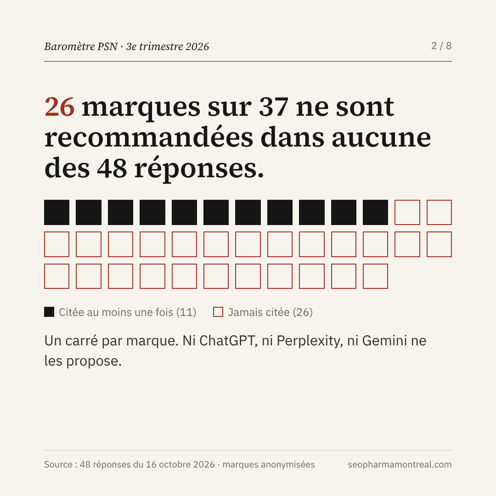
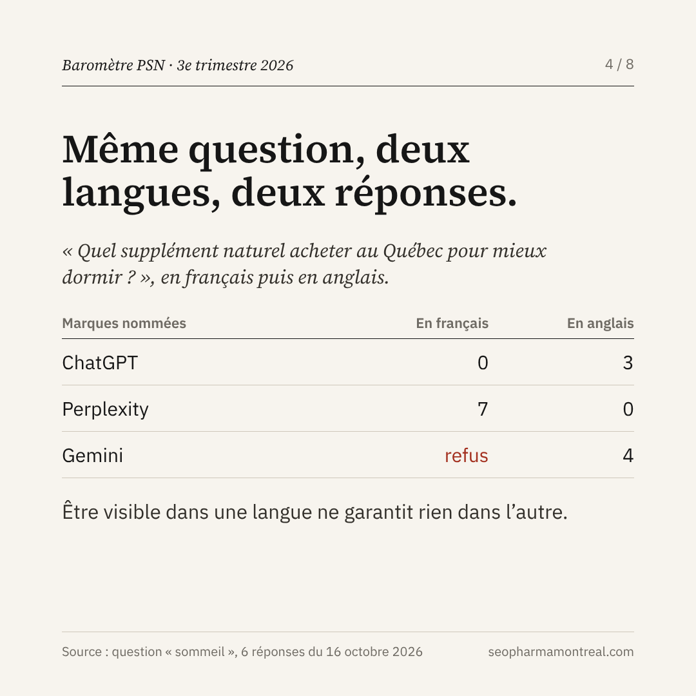

Quand un acheteur demande à une IA quel produit de santé naturel acheter au Canada, sans nommer de marque, qui est recommandé ? J’ai posé la question 48 fois à ChatGPT, Perplexity et Gemini, en français et en anglais. Sur 37 marques canadiennes de PSN, **26 ne sont jamais recommandées**.

## En bref

- **11 marques sur 37** sont recommandées au moins une fois (30 %).
- **4 marques nationales** prennent 41 des 56 citations de l’échantillon (73 %).
- **66 % des citations** vont à des marques hors échantillon, dont des marques étrangères (111 sur 167).
- **9 marques québécoises sur 12** ne sont jamais citées.
- **8 points de vigilance** : 3 erreurs d’origine et 5 allégations ou NPN attribués à des produits.

## La méthode

| Élément | Détail |
|---|---|
| Échantillon | 37 marques canadiennes de produits de santé naturels, dont 12 québécoises, siège vérifié le 17 octobre 2026 (50 présélectionnées, 13 écartées : domaine inactif, siège hors Canada ou non vérifiable) |
| Questions | 8 questions d’acheteur sans nom de marque : vitamines, probiotique, sommeil, oméga-3, immunité avec NPN, meilleures marques, stress, suppléments liquides pour enfants (gouttes, sirops) |
| Langues | Français (formulé pour le Québec) et anglais (formulé pour le Canada) |
| IA | ChatGPT (gratuit, discussion temporaire, sans mémoire), Perplexity (gratuit), Gemini (discussion temporaire) |
| Réponses | 48, un essai chacune, le 16 octobre 2026 |

Une marque est comptée quand l’IA la recommande ou la propose. Une marque citée seulement comme source d’information n’est pas comptée. Les noms des marques sont volontairement masqués.

## 1. Un cercle fermé

Les quatre mêmes marques nationales reviennent dans les réponses sur les vitamines, les oméga-3, le sommeil et l’immunité. Les sept suivantes sont citées entre une et cinq fois. Les 26 autres, jamais.

Ces 26 marques vendent pourtant au Canada. Le problème n’est pas forcément la qualité du produit : l’IA ne trouve peut-être pas, sur le web, de quoi le recommander.

## 2. Certaines catégories sont presque fermées, d’autres encore ouvertes

| Question d’acheteur | Réponses avec une marque de l’échantillon (sur 6) | Marques différentes citées | Réponses sans marque |
|---|---|---|---|
| Vitamines canadiennes | 6 | 9 | 0 |
| Oméga-3 le plus fiable | 5 | 12 | 0 |
| Meilleures marques de PSN | 4 | 31 | 0 |
| Sommeil | 3 | 12 | 3 |
| Immunité, produit avec NPN | 3 | 9 | 1 |
| Suppléments liquides pour enfants | 2 | 24 | 0 |
| Probiotique fabriqué au Canada | 0 | 10 | 0 |
| Stress, en vente libre | 0 | 0 | 6 |

Sur le stress, aucune IA ne nomme de marque : elles parlent seulement d’ingrédients. C’est une catégorie où la première marque qui publie un contenu clair et vérifiable a une place à prendre.

## 3. La langue change la réponse

Cinq marques de l’échantillon sont citées dans les deux langues, trois seulement en français, trois seulement en anglais. Sur le sommeil, ChatGPT ne nomme aucune marque en français et trois en anglais. Gemini refuse de répondre en français (« je ne suis pas conçu pour aider avec cela ») et répond en anglais avec une liste de marques.

À la question « quelles sont les meilleures marques québécoises de PSN ? », une seule marque québécoise de l’échantillon apparaît, dans une réponse sur trois. Au Québec, il faut [vérifier sa visibilité](/blog/geo-pharma-chatgpt-perplexity-sante-2025/) dans les deux langues.

## 4. Ce que l’IA dit est-il juste ?

Pour une [marque de PSN](/seo-psn/), une erreur d’IA n’est pas qu’un problème de visibilité. Huit points de vigilance ont été relevés :

- **3 erreurs d’origine, confirmées ou probables** : une marque ontarienne classée parmi les « meilleures marques québécoises », une marque californienne présentée « Made in Canada », une marque d’oméga-3 attribuée à une autre entreprise que son propriétaire.
- **5 allégations ou NPN attribués, à vérifier** : des indications santé associées à des probiotiques précis, des NPN cités sans vérification possible, une allégation reprise d’un document non officiel.

Un point de vigilance signale une affirmation à vérifier. Ce n’est ni un avis juridique ni un constat de non-respect de la réglementation.

Le bon réflexe existe aussi : Perplexity, en français, recommande un produit pour l’immunité en citant son [NPN et son usage autorisé](/blog/allegations-psn-ce-qui-est-permis-canada-2026/). C’est le type d’information précise qu’une marque a intérêt à rendre facile à trouver.

## Trois décisions pour une marque de PSN

1. **Cette semaine : mesurer.** Poser à ChatGPT, Perplexity et Gemini les trois questions d’acheteur de sa catégorie, en français et en anglais. Noter qui est cité et ce qui est dit de la marque.
2. **Ce mois-ci : publier le NPN.** Afficher sur chaque fiche produit, dans les deux langues, le NPN et l’usage autorisé tels qu’ils figurent dans la [base de Santé Canada](https://health-products.canada.ca/lnhpd-bdpsnh/index-fra.jsp).
3. **Ce trimestre : corriger les faits.** Rendre l’origine, le fabricant et le propriétaire de la marque cohérents partout où les IA lisent : site, détaillants, annuaires, médias.

  <a href="/rapports/barometre-psn-2026-t3.pdf" class="btn btn-primary btn-lg">Télécharger le rapport complet (PDF, 5 pages)</a>

## Limites

- 47 réponses sur 48 s’appuient sur une recherche web (la 48e est un refus) : la version gratuite de ChatGPT ne permet pas de la désactiver.
- Un seul essai par question : une autre date, un autre compte ou une autre ville peuvent changer le résultat.
- Plusieurs points de vigilance restent à vérifier dans la [base des produits de santé naturels homologués](https://health-products.canada.ca/lnhpd-bdpsnh/index-fra.jsp).

La prochaine édition vérifiera, pour les marques citées, si l’IA les choisit face à leurs concurrents, avec et sans recherche web.

---

*Vous voulez savoir ce que les IA répondent sur votre catégorie ? Écrivez-moi : [soulimane@seopharmamontreal.com](mailto:soulimane@seopharmamontreal.com).*
